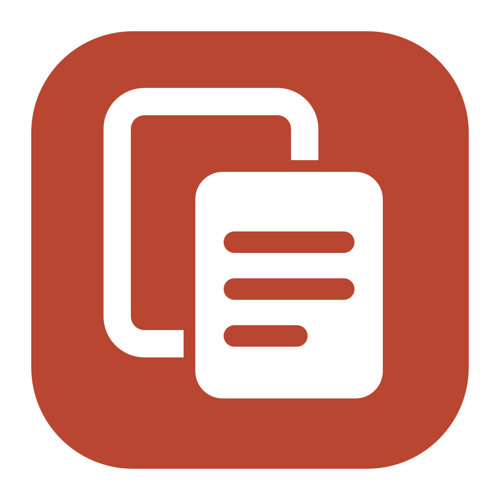
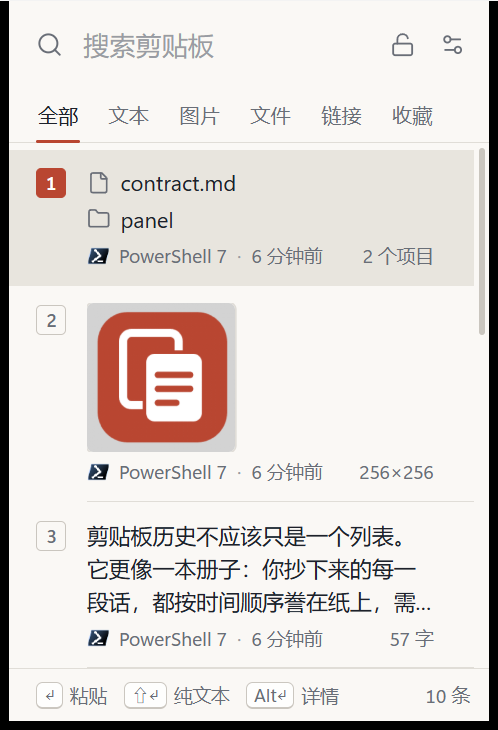
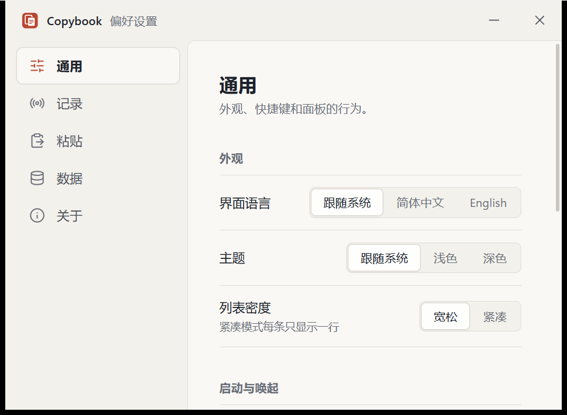

<div align="center">
  

# Copybook

**Windows 剪贴板历史，键盘优先。**<br/>
把复制过的东西，都誊在一本册子里。

[English](#english) · MIT




</div>

## 它做什么

Copybook 常驻托盘，记下你复制的文字、富文本、图片和文件。按 <kbd>Alt</kbd>+<kbd>V</kbd>，
面板出现在鼠标旁边：输入几个字就能搜到，<kbd>Enter</kbd> 直接粘贴回刚才的程序。

- **记录**：纯文本（同时保留 HTML / RTF 格式）、图片、文件和文件夹；同样的内容只留一条，
  再次复制时移到最前。
- **识别**：链接、邮箱、颜色值、文件路径和代码片段各有自己的显示方式。
- **搜索**：全文搜索，一两个汉字也能搜；可按 文本 / 图片 / 文件 / 链接 / 收藏 筛选；备注也能被搜到。
- **整理**：收藏、置顶、给记录写备注（以朱红色批注显示）。
- **批量操作**：Ctrl / Shift 多选、全选完整筛选结果、批量删除，15 秒内可撤销；多条文字按自选分隔符合并复制。
- **筛选与文件夹**：关键词、类型、来源应用、起止日期组合筛选；收藏支持多级文件夹、空目录和面包屑导航，直接在目录中重命名、移动或移除文件夹，单条或批量移动收藏。
- **常用片段**：在收藏目录中新建或编辑文本，右键可移至其他目录、在当前目录上移或下移。目录顺序会保留，置顶项优先。
- **加密备份**：「偏好设置 → 数据」通过 WebDAV 备份与合并恢复，默认使用 `copybook/` 子目录。历史、图片和设置在本机加密后上传。WebDAV 登录密码和备份加密密码可分别记住，保存在当前用户的 Windows 凭据管理器中。详见 [v1.6.0 说明](docs/releases/v1.6.0.md)。
- **来源**：可在「偏好设置 → 通用 → 面板」中关闭来源应用的名称和图标显示。
- **粘贴**：<kbd>Enter</kbd> 粘贴，<kbd>Shift</kbd>+<kbd>Enter</kbd> 换一种格式（纯文本 / 原格式），
  <kbd>Ctrl</kbd>+<kbd>1</kbd>–<kbd>9</kbd> 直接粘贴前九条。
- **隐私**：遵从密码管理器的"不要记录"标记，跳过私钥、访问令牌和 JWT，可以忽略指定程序；
  历史默认保存在本机，主动创建的 WebDAV 备份会以加密形式上传。
- **其他**：可选接管 <kbd>Win</kbd>+<kbd>V</kbd>，开机自启，浅色 / 深色，宽松 / 紧凑两种密度，中文 / English。

## 面板快捷键

| 按键 | 作用 |
| --- | --- |
| <kbd>↑</kbd> <kbd>↓</kbd> / <kbd>PgUp</kbd> <kbd>PgDn</kbd> | 选择 |
| <kbd>Enter</kbd> | 粘贴选中的记录 |
| <kbd>Shift</kbd>+<kbd>Enter</kbd> | 换一种格式粘贴 |
| <kbd>Ctrl</kbd>+<kbd>1</kbd>–<kbd>9</kbd> 或 <kbd>Ctrl</kbd>+<kbd>Shift</kbd>+<kbd>1</kbd>–<kbd>9</kbd> | 粘贴第 1–9 条（部分程序的 <kbd>Ctrl</kbd>+数字被系统占用，可改用加 <kbd>Shift</kbd> 的组合） |
| <kbd>Alt</kbd>+<kbd>Enter</kbd> | 查看详情 |
| <kbd>Ctrl</kbd>+<kbd>C</kbd> | 只复制，不粘贴 |
| <kbd>Ctrl</kbd>+<kbd>S</kbd> / <kbd>Ctrl</kbd>+<kbd>P</kbd> | 收藏 / 置顶 |
| <kbd>Ctrl</kbd>+<kbd>Del</kbd> | 删除 |
| <kbd>Tab</kbd> | 切换分类 |
| <kbd>Esc</kbd> | 退出多选 / 清空搜索 / 返回上级收藏目录 / 关闭面板 |
| <kbd>F2</kbd> | 文件夹按钮获得焦点时重命名 |
| <kbd>Ctrl</kbd>+<kbd>N</kbd> / <kbd>Ctrl</kbd>+<kbd>E</kbd> | 新建 / 编辑收藏片段 |
| <kbd>Alt</kbd>+<kbd>↑</kbd> / <kbd>Alt</kbd>+<kbd>↓</kbd> | 在当前收藏目录上移 / 下移选中项 |
| <kbd>Ctrl</kbd>+<kbd>,</kbd> | 偏好设置 |

## 安装

从 [Releases](https://github.com/wio-ki/Copybook/releases) 下载 `Copybook_x.y.z_x64-setup.exe`。
安装到当前用户，不需要管理员权限。需要 Windows 10/11（系统自带 WebView2）。

从 v1.3.0 起，可在「偏好设置 → 关于 → 检查更新」中直接下载并安装新版。
更新包会进行签名和版本校验，自动覆盖安装并重启，保留历史和设置，无需手动卸载。
v1.2.0 及更早版本需先覆盖安装 v1.3.0 一次，之后即可使用应用内更新。

> 目标程序以管理员身份运行时，Windows 不允许普通程序向它发送按键：这时 Copybook 会把内容
> 放进剪贴板并提示你手动 <kbd>Ctrl</kbd>+<kbd>V</kbd>。
> 也可开启「偏好设置 → 通用 → 以管理员权限运行」。开关会保存，之后每次启动（包括开机自启）
> 都会请求 Windows UAC 授权并以管理员身份运行；关闭开关后，下次启动恢复普通权限。
> 取消首次开启时的授权会撤销开关；已开启后，启动时取消授权会退出，避免以普通权限运行。

在 Codex CLI / Claude Code CLI 中粘贴图片：先让 CLI 获得焦点，再打开 Copybook，双击图片记录。
终端会收到一个带引号的 PNG 文件路径，CLI 将它识别为图片附件；无需修改任何快捷键。
支持 Windows Terminal、传统控制台、mintty 等本机终端。路径包含中文或空格时也能识别。

## 从源码构建

需要 Node 20+、Rust stable，以及 VS 2022 Build Tools（"使用 C++ 的桌面开发"）。

```bash
npm install
npm run dev            # 只启动前端，浏览器里用模拟数据预览界面
npm run tauri dev      # 完整应用
npm run tauri build    # NSIS 安装包：src-tauri/target/release/bundle/nsis
cd src-tauri && cargo test
```

## 结构

```
docs/contract.md   前后端契约：命令、事件、类型、设置与行为（唯一事实来源）
src/               前端：React + TypeScript，手写 CSS（设计令牌在 src/styles/tokens.css）
  panel/           剪贴板面板
  settings/        偏好设置窗口
  shared/          契约镜像、API 封装、模拟后端、文案
src-tauri/         后端：Rust + Tauri v2，SQLite（FTS5 trigram）、Win32 剪贴板与粘贴
design/            图标源文件
```

数据位于 `%APPDATA%\io.github.wio-ki.copybook\`：`copybook.db`、`settings.json`、`images\`。

## 致谢

功能设计参考了 [EcoPaste](https://github.com/EcoPasteHub/EcoPaste)（Apache-2.0）。Copybook 的代码与界面为独立编写。

---

## English

Copybook is a keyboard-first clipboard history for Windows 10/11. It lives in the tray and keeps
the text (with HTML/RTF), images and files you copy. Press <kbd>Alt</kbd>+<kbd>V</kbd>, type a few
characters, press <kbd>Enter</kbd>, and the item is pasted back into the app you were using.

Highlights: full-text search that also works for one or two Chinese characters; filters for text,
images, files, links and starred items; stars, pins and notes; <kbd>Shift</kbd>+<kbd>Enter</kbd>
for plain text; <kbd>Ctrl</kbd>+<kbd>1</kbd>–<kbd>9</kbd> or <kbd>Ctrl</kbd>+<kbd>Shift</kbd>+<kbd>1</kbd>–<kbd>9</kbd> quick paste; respects password-manager
"do not record" hints and skips keys and tokens; optional <kbd>Win</kbd>+<kbd>V</kbd> takeover;
light and dark themes; Chinese and English UI. History is stored locally and WebDAV uploads
are encrypted.

Favorites supports persistent nested folders, including empty directories, with breadcrumbs
and an All favorites view. Rename (F2), move or remove folders from their directory menu;
move individual items or a selection using Move to folder. Removing folders keeps their items
starred at the root. Create or edit text snippets and reorder items in each folder. Encrypted
WebDAV backups preserve the hierarchy, empty folders, snippets and custom order. Settings → Data
can remember the WebDAV and encryption passwords in Windows Credential Manager for the current user.

Source app names/icons can be hidden in Preferences → General → Panel. From v1.3.0,
Preferences → About downloads and verifies signed updates, installs over the existing app
and restarts it without a manual uninstall. History and settings are preserved. Versions
before v1.3.0 need one installer upgrade to gain the in-app updater.

Preferences → General offers a persistent **Run as administrator** switch. Every later launch,
including start at login, requests Windows UAC approval when needed. Turning it off takes effect
on the next launch. Cancelling initial approval restores the switch; cancelling a later startup
exits instead of running with normal permissions.

To attach an image in Codex CLI or Claude Code CLI, focus the CLI, open Copybook and double-click
the image. Local terminal hosts receive a quoted PNG path that the CLI recognizes as an image
attachment, including paths with spaces or Chinese characters. No shortcut changes are needed.

Build from source with the commands above. The frontend/backend contract lives in
`docs/contract.md`. Feature set inspired by [EcoPaste](https://github.com/EcoPasteHub/EcoPaste).

MIT License.
